# Enkai group agent: server-side design

## 1. Summary

Enkai should stop people spending time coordinating: the agent collects limits, negotiates workable times and places, and asks only what is needed to agree. Start with proposals and human confirmation; later, members may delegate bounded decisions. The agent receives only consented availability, never calendar titles. Preserve existing dinners/invitations while adding shared negotiation history. Returning groups, permitted preference memory, trusted communities and venue relationships create the moat.

### MVP at a glance

The organizer enters the dinner window, area, duration and expected headcount N (including the organizer), creates named guest placeholders and marks required people, then shares one existing dinner link. N and required flags freeze before collection; each signed-in guest explicitly claims their own placeholder by picking their name within the join/**Share my limits** step, with no extra decision submission. Optional slots bind immediately; only required guests need the organizer's one-tap match confirmation before their approvals count. The organizer sees who claimed each slot, can undo a wrong claim, and resolves contested or duplicate claims. Guests submit limits, then see a recommended plan and explanation: **Approve and attend** or **Cannot do this**. The organizer's **Approve and finalize** records the final approval and checks all required people plus `max(required_count, ceil(2*N/3))` exact-version approvals; unanimous is an explicit alternative. The happy path needs three organizer coordination actions plus one confirmation per required guest (four actions in Ana's example); guest decision counts stay unchanged. Names alone never establish verified identity for quorum beyond the explicit signed-in claim; each slot binds at most one account, and each account at most one slot.

**In:** private dinners of 2-12, manual limits, three candidates per round/three rounds maximum, required people plus minimum attendance, exact-plan approval, human finalization, history and invite compatibility. Include optional sanitized free/busy for already-connected calendars behind `group_free_busy`. **Out:** mandatory calendar connections, automatic finalization, messaging delivery, reservations/payments, visible permanent groups, reusable preference memory and communities.

**Minimum NEW storage:** `groups`, `group_members`, `negotiation_sessions`, `negotiation_proposal_versions`, `negotiation_responses`, `group_member_constraints`, `negotiation_command_receipts`, `negotiation_jobs`, `negotiation_events`. The calendar flag additionally needs `group_calendar_consents` and `group_availability_snapshots`. Section 3 scopes deferred tables.

**Minimum NEW commands:** `negotiation-start`, `negotiation-input`, `proposal-respond`, `negotiation-advance`, `negotiation-finalize`, `negotiation-cancel`; calendar flag adds `availability-consent` and `availability-revoke`. Reuse authenticated dinner reads/joining and sharing. Inputs save limits/optional consent together; finalization records organizer approval. These are proposed endpoints.

**Rough total:** 3-5 person-weeks manual-only; **4-7 with the recommended calendar pilot**, including UI, compatibility/backfill, privacy and rollout checks. OAuth onboarding adds steps (section 8).

### Glossary

- **Session:** one dinner's negotiation and history.
- **Proposal:** a specific time, duration, zone and restaurant; changes create a new version.
- **Round:** one published set of proposals and responses.
- **Required person:** someone whose explicit approval is essential.
- **Quorum:** the minimum number of distinct people approving the same plan.
- **Grant/delegation:** explicit permission for the agent to act within stated rules.
- **Free/busy:** occupied time intervals without event details; free does not mean willing.
- **Projection:** a filtered view of negotiation records shaped for the existing dinner/UI.

## 2. Current state and blockers

This design is based on local source and all 15 files in `supabase/migrations/`; deployment state was not inspected. Names marked **NEW** below are proposals, not existing infrastructure.

| Existing source | Verified behavior and implication |
| --- | --- |
| `202611100001_meal_planner.sql` | `public.meal_plans(id, invite, owner, details, version, created_at)` holds a dinner. `public.meal_plan_members(meal_id, account, display_name, response)` has a composite primary key. `details` contains `times`, `restaurants`, `selectedTime`, `restaurant`, `guests`, `attending`, `duration`, `status`, and optionally `timeZone`. One final time and restaurant; no negotiation history. `manage` checks owner/version and retains existing options. |
| `meal-planner/index.ts`, under `supabase/functions/` | Verifies Google/Microsoft tokens or hashed remembered sessions, then uses a service-role client. Actions include `create`, `list`, `join`, `manage`, `vote`, `respond`, `rsvp`, `suggest`, `places`, and preview/photo actions. Input limits include 10 times, 30 restaurants, and 50 guest/attending names. There is no agent principal or delegation. |
| `202611100002_meal_microsoft.sql`, `202611100004_meal_remembered_sessions.sql` | `meal_microsoft_links(microsoft_sub, google_sub)` links verified identities; `meal_microsoft_action` merges owners/members. `meal_remembered_sessions(token_hash, account, display_name, microsoft, expires_at)` remembers sign-in, not group authority. Accounts are provider-derived text, not established `auth.users` UUIDs. |
| `202611100003_meal_suggestions.sql` | `meal_restaurant_suggestions(meal_id, account)` limits a guest to one suggestion while restaurant voting is open. Finalization is host-only, but search is not universally host-only: authenticated `places` has no meal-owner check, and guests can search through `browseRestaurants(true)` in `planner.js`. The agreed-time shortcut in `group-finder.js` is organizer-gated. |
| `202611110001_meal_rsvp.sql`, `202611120001_meal_response.sql`, `202611140001_availability_before_rsvp.sql` | RPC layers are now `meal_planner_action` → `meal_planner_before_calendar` → `meal_planner_rsvp_action` → `meal_planner_suggestions_action` → `meal_planner_base_action`, with action-specific interception. Availability precedes attendance. `respond` checks plan version; legacy `vote` does not. Whole-plan versions cannot describe which dimension someone answered. |
| `202611260001_cancelled_dinner_guard.sql` | The latest outer RPC locks and rejects cancelled dinners for `respond`, `rsvp`, `manage`, `vote`, `suggest`. Preserve that guard on every new mutation and worker path. Existing `join` is outside that operation list. |
| `dinner-state.js`, `tests/dinner-state.test.cjs` | Pure UMD `EnkaiDinnerState.derive(meal,{now,role})` returns stage, `nextAction`, tallies, `noneCounts`, unique leaders, and tie arrays. Every response counts equally; zero votes/ties have no leader. Cancellation wins; final guest RSVP/reconfirmation precedes reservation status. It reads supplied data; current `list` exposes full `responses` only to the organizer. |
| `planner.js`, `planner-mobile.js`, `planner-venues.js` | `save()` persists `wishes`, `people`, `busy` in device `localStorage`; meals are loaded from the server. Drafts use `enkai-plan-draft`/`enkai-response-draft` in `sessionStorage`. Guest names and `attending` are unverified notes. Venue catalog entries and guide favorites are not shared group preferences. `noneChoice()` deliberately does not infer intentional none from old empty arrays. |
| `group-finder.js`, `group-shortlist.js` | `openGroupFinder()` requires an organizer, agreed date, and no restaurant/poll. `EnkaiGroupPicks.shortlist()` returns up to three Places results using price bands and rating × log(review count). Unknown prices pass filtering; neither seating nor booking availability is verified. |
| Calendar source/migration | `202611120002_calendar_sync.sql` adds `meal_calendar_profiles`, `meal_calendar_connections`, `meal_calendar_oauth_states`, `meal_calendar_events`, `meal_calendar_replies`, `meal_calendar_jobs`. `_shared/calendar.ts` implements `calendarAction`, `checkConflicts`, `syncDinner`, `runCalendarJobs`; `_shared/calendar-core.ts` supplies normalization, overlap, `scheduleKey`, `isConfirmed`. Conflicts are private to the requesting account and currently include titles. OAuth grants event read/write access, not group consent. `calendar-callback/index.ts` completes OAuth and starts persisted jobs; `calendar-worker/index.ts` requires `CALENDAR_WORKER_SECRET`. |
| Preview and resource limits | Public `preview` returns a thin dinner allowlist; `preview-photo` returns imagery. `preview-service/core.mjs` redirects humans and renders crawler metadata; `preview-service/api/invite.mjs` adapts GET/HEAD, `preview-service/vercel.json` routes `/i`, and its README describes separate hosting. It is not an authenticated negotiation read model. `202611100005_meal_places_monthly_cap.sql` and the response/photo migrations cap searches/photos separately at 900/month; `202611140002_invitation_photo_limits.sql` and `202611140003_invitation_photo_group_limits.sql` leave invitation photos at 30/minute, 150/day per dinner. |

`dining-poll/index.ts` and the three `20261013...` migrations implement dining-guide ballots/counts, initials and edits for `sao-paulo-2026`; these establish no dinner membership or negotiation consent.

## 3. Data model: groups/communities, members, roles, invites/identity

All following tables and columns are **NEW sketches**, documented here only; the MVP subset above governs implementation scope. UUID `id` is the default primary key; arrows denote foreign keys. Use typed/versioned JSON for bounded policy, roster, options and constraints. Validate ranges, enums, currency, references, and same-session/group ownership transactionally. Index foreign keys and due-work timestamps.

Retain existing tables as the compatibility surface. Add **NEW** nullable `meal_plans.group_id` and `meal_plans.negotiation_session_id`; proposals hold many combinations, while accepted output still projects to one `details.selectedTime` and `details.restaurant`. MVP groups are implicit one-dinner containers. Later, persistent groups can own many dinners; communities organize groups without inheriting dinner access.

| NEW table | Key columns and keys | RLS/access intent |
| --- | --- | --- |
| `group_accounts` | `id`, `created_at`, `disabled_at` | Self identity; verified server provisioning only. |
| `group_account_aliases` | `account_id → group_accounts`, `legacy_account`; unique `legacy_account` | Internal mapping only; preserve current canonical account strings. |
| `communities` | `id`, `name`, `visibility`, `policy_version` | Explicit community membership; private default. |
| `community_members` | PK `(community_id, account_id)`, `role`, `state` | Active members see permitted roster; owner/admin manages membership, not personal constraints. |
| `groups` | `id`, `community_id?` (later), `name`, `kind` (implicit/persistent), `policy`, `policy_version`, `archived_at` | Active group members; community membership alone grants nothing. |
| `group_members` | `id`, `group_id`, `legacy_account?` (MVP), `account_id?` (later), `label`, `role`, `state`; unique non-null `(group_id, legacy_account)`; later `(group_id, account_id)` | Owner/admin/member roles; invited placeholders cannot act. Keep a surviving owner on transfers/removals. |
| `group_invites` | `id`, `group_id`, `session_id?`, `member_id?`, `token_hash`, `expires_at`, `revoked_at`, `max_uses`, `uses`; unique hash | Server redemption only; admin manages own group's invites. Dinner-scoped redemption cannot grant persistent membership. |
| `negotiation_sessions` | `id`, `group_id`, `roster_v1`, `dimensions_v1`, `meal_id → meal_plans`; unique `meal_id`; `state`, `revision`, `round`, `deadline_at`, `policy_snapshot`, `membership_version`, `input_hash`, `accepted_proposal_version_id?` | Authorized session participants; worker writes through guarded commands. |
| `negotiation_participants` | PK `(session_id, member_id)`, `required`, `included`, `participation_state` | Frozen decision roster, versioned on changes; group members outside it cannot read the dinner. |
| `negotiation_dimensions` | PK `(session_id, dimension)`, `options_version`, `open`, `options` | Participant read; guarded writes. Stable option IDs; distinguish time, restaurant, and joint-plan ballots. |
| `negotiation_proposals` | `id`, `session_id`, `created_by`, `supersedes_id?` | Session-readable identity; edits create versions. |
| `negotiation_proposal_versions` | `id`, `proposal_id` (MVP logical UUID; later FK), `session_id`, `supersedes_id?`, `version`, `round`, `start_at`, `duration_minutes`, `time_zone`, `venue_key`, `venue_label`, `evidence_refs`, `input_hash`, `score_breakdown`, `scorer_version`; unique `(proposal_id, version)` | Immutable versions; group-safe facts only. Approval references exact version. |
| `negotiation_responses` | `id`, `session_id`, `member_id`, `dimension`, `options_version`, `answer_state`, `option_ids`, `proposal_version_id?`, `supersedes_id?`, `received_at`, `source` | Member submits own immutable revisions; participants see only policy-approved aggregates. Latest valid revision is the read model. |
| `group_member_constraints` | `id`, `member_id`, `session_id?`, `dimension`, `version`, `strength`, `value`, `visibility`, `source`, `confirmed_at`, `expires_at` | Owner and authorized evaluator only by default; session override beats group default. Never expose raw private values through aggregates. |
| `group_calendar_consents` | `id`, `member_id`, `group_id`, `session_id?`, `provider`, `calendar_scope`, `horizon_days`, `purpose`, `version`, `expires_at`, `revoked_at` | Self grant/revoke; evaluator checks current record. Provider connection is separate. |
| `group_availability_snapshots` | `id`, `consent_id`, `consent_version`, `session_id`, `range_start/end`, `busy_intervals`, `checked_at`, `expires_at`, `coverage_status` | Private evaluator/owner only; group receives candidate compatibility, not individual timelines. No titles, event IDs, or attendees. |

**MVP simplifications:** lock a bounded versioned session roster (member IDs, required/included/state) and dimension metadata on changes. At creation, the organizer sets expected headcount N (including themselves), fills the other N-1 slots with named `group_members` placeholders, and marks required people, always including the organizer. Freeze N and required flags before sharing today's dinner link and collecting inputs; bind the organizer immediately. Each guest joins with a verified account through that link and explicitly claims their own placeholder by picking their name within the join/**Share my limits** step, not a separate decision submission. Optional placeholders bind immediately on self-claim. Required claims may submit limits but remain pending until the organizer confirms the identity-to-placeholder match in one tap; their approvals cannot count before confirmation. The organizer sees who claimed which slot and can undo a wrong claim. Contested or duplicate claims go to the organizer for resolution, remain pending and cannot displace an existing binding or count toward quorum. Binding or undo preserves the slot's required flag and N, is revisioned, and invalidates affected approvals. Unmatched joins remain pending outside the decision roster and cannot read session details or cast approvals; names alone never establish verified identity for quorum beyond the explicit signed-in claim. Enforce one account per slot and one slot per account. Unbound slots remain in N and required ones block finalization. Changing slot count or required flags requires an explicit policy/roster revision and revalidation of affected approvals, never an automatic change on join or silence. Responses reference `group_members.id`; enforce roster ownership. Defer normalized `negotiation_participants`, `negotiation_dimensions`, `negotiation_proposals`; backfill keys later without rewriting approvals. Defer accounts/aliases, communities/members, persistent invites and their FK columns. The nine core tables above suffice; the calendar pilot adds only the two consent/snapshot tables. A prior-dinner verified-identity picker is a later-phase option alongside persistent membership, not an MVP dependency.

Constraints cover local recurring/date-specific time windows with IANA zone and DST occurrence; budget per person with currency and tax/tip assumptions; dietary requirements/allergens; coarse departure area, travel mode and maximum minutes; cuisine preferences/avoidances. Strength is hard or soft, explicitly chosen. Unknown travel, exact prices, or allergy suitability remain unknown. Never infer medical details or turn a cuisine label into an allergy guarantee. Group memory requires separate opt-in, provenance, and editable expiry; session-only is default.

Today's anonymous visitors can preview, but server dinner responses require verified Google/Microsoft sign-in. Device names do not represent anonymous authenticated people. MVP member rows use verified canonical account strings from `canonicalAccount()` and `meal_microsoft_links`, unique per group. Linking requires both identities and transactional reconciliation; never duplicate quorum or union grants/consents. Later backfill internal accounts/aliases from canonical strings, never name/email. An unmatched, contested or duplicate shared-link claim remains pending for organizer resolution; a required self-claim needs organizer confirmation before binding. No join or claim enlarges N automatically. One verified person can bind only one roster slot. Local guests, wishes, drafts, and busy blocks are imported only after device-owner review; busy blocks need an explicit zone. Names alone cannot establish verified identity for quorum beyond the explicit signed-in claim, or establish attendance.

**Privacy defaults:** joining grants no calendar access. Each person opts into group/session scheduling, selected connected calendars, a maximum 30-day horizon, and expiry. Share only free/busy with the evaluator; never event titles with the group, agent, LLM, logs, or previews. Build a separate sanitizer/provider adapter rather than forwarding `checkConflicts()` output (which includes titles near line 186). Existing OAuth scopes are broader, so explain them and investigate narrower read-only grants independently of invitation writing.

Proposed retention: availability expires after 15 minutes and is physically purged within 24 hours; refresh consenting prospective attendees within five minutes before finalization. Session constraints expire 30 days after dinner; persistent preferences require opt-in renewal annually. Revocation immediately blocks reads/use, invalidates snapshots and unsent work, and triggers purge within 24 hours. Leaving a group has the same effect. Disconnecting a provider invalidates all dependent consents; per-group revocation need not disconnect other groups. Detailed calendar consent is separate from exposing attendee email addresses in calendar invitations. Already-sent invitations need explicit cleanup handling; revocation cannot erase recipients' copies.

## 4. Negotiation loop

Use deterministic code for feasibility, scoring, state transitions, authorization, and deadlines. An LLM may parse free text into a proposed constraint, summarize tradeoffs, or draft nudges. Humans confirm parsed constraints before enforcement. The model gets redacted facts, no credentials or raw calendar data, and cannot directly execute a tool.

1. **Collect:** snapshot participants, required attendees, decision policy, destination zone, horizon, duration, constraints, consent coverage, prior answers, and venue evidence. Distinguish unavailable, unanswered, stale, and unknown. Input changes advance `revision`; changed feasibility/authority invalidates affected approvals. Unchanged refresh timestamps alone do not.
2. **Generate:** intersect hard windows and busy intervals, including travel buffers; enumerate 30-minute starts for at most 30 days. Reject DST gaps and require an occurrence for ambiguous wall times, matching `meal-time.js`. Combine feasible slots with bounded venue candidates from guide IDs, user-entered venues, or Places IDs. Search at most once per changed area/cuisine query per round; respect existing caps and provider storage terms. Present at most three combinations. A time-only proposal is allowed while venues are unknown; it cannot finalize dinner.
3. **Eligibility:** default to all organizer-marked required people **plus quorum** approving the exact joint version. Organizer is required; set minimum `max(required_count, ceil(2*N/3))` for expected roster size N frozen at creation before link sharing/collection, including the organizer and every guest placeholder (four friends means three approvals). Display N, required people and threshold before collection. Shared-link guests explicitly self-claim in the join/**Share my limits** step: optional slots bind immediately; required slots need the organizer's one-tap match confirmation before their approvals count (section 3). Contested or duplicate claims await organizer resolution; wrong claims can be undone. Names alone never establish verified identity for quorum beyond the explicit claim; one account binds per slot and each account only once, without changing N or required flags. Unanimous is an explicit alternative. Count distinct verified people once. Silence, `maybe`, stale votes and free calendars never count; unanswered optional invitees remain unconfirmed, never "going." Unbound or unconfirmed required placeholders block finalization; unbound optional placeholders count in N, never approvals. No silent denominator/roster changes. Respect every included person's submitted hard constraints even if quorum is otherwise possible: that person must amend or explicitly opt out; never optimize them away. Unknown optional availability is not represented as clear.
4. **Score:** among feasible candidates, maximize lexicographically accepted coverage, minimum member utility, mean utility, then minimize repeated inconvenience. Utility is a versioned 0–100 weighted combination of member-declared soft time, budget, travel, and cuisine preferences; missing preferences are neutral, not invented. Equal member weights; optional history penalty only from consented past choices, with bounded influence. Store component values and exclusions privately. Do not let restaurant popularity overpower feasibility or fairness.
5. **Round:** publish immutable proposals and dimension versions. Collect joint approval or rejection plus optional reason; independent time/restaurant votes inform generation, not joint consent. Recompute only when inputs change, debounce bursts, and ask about the highest-impact unknown. Preserve superseded proposals and reasons. Nudge at most once/member/day, respecting quiet hours and opt-out; MVP drafts reminders for manual sharing because no delivery service exists.
6. **Converge:** a unique proposal moves to final review when required guests have approved and the organizer's one approval would satisfy quorum. Equal approval leaders or equal final score tuples remain tied; stable ordering is presentation only. Match `derive()` by exposing ties and leaving the selected value empty. Request a runoff or named human choice; existing exact-version approvals survive selection alone, while changed proposals require fresh approval. No random, alphabetical, earliest-time, or host-weighted automatic winner.

Default deadline is 48 hours after collection starts, at least 24 hours before dinner; shorter notice needs explicit policy. Allow three rounds with at most one runoff, then request intervention. Deadline expiry never converts silence to yes. Human options are extend, revise constraints, explicitly change the participant set, choose a tied plan through the approval rules, or abandon. Finalization changes are atomic with the legacy projection and calendar enqueue; calendar synchronization and restaurant reservation are separate outcomes.

**Human intervention is mandatory:** no feasible slot/venue; unresolved required person, identity, or tie; ambiguous/low-confidence parsing; unverified hard budget, travel, allergy, or seating evidence; stale/incomplete calendar coverage for counted attendees without explicit manual availability confirmation; requested override of someone's stated constraint (that person must amend it); changing quorum/required roster; and any cost, deposit, hold, booking, or cancellation commitment. MVP combines the organizer's exact-plan approval and finalize into one command, rechecking the full rule atomically. Guest **Approve and attend** explicitly records conditional attendance for that version; the unchanged finalized projection carries it forward, avoiding a third RSVP. It does not authorize calendar acceptance. Later `finalize-within-rules` may skip the organizer click only with current group/member delegation and no exception above.

```mermaid
stateDiagram-v2
    [*] --> collecting
    collecting --> proposing: sufficient validated inputs
    proposing --> awaiting_responses: publish round
    proposing --> needs_human: infeasible or uncertain
    awaiting_responses --> proposing: changed inputs / next round
    awaiting_responses --> ready_to_finalize: required guests approved; organizer can complete quorum
    awaiting_responses --> needs_human: tie / round limit
    ready_to_finalize --> finalized: human approval or valid delegation
    ready_to_finalize --> collecting: stale input / revoked authority
    needs_human --> collecting: approved revision
    collecting --> expired: deadline
    proposing --> expired: deadline
    awaiting_responses --> expired: deadline
    ready_to_finalize --> expired: deadline
    needs_human --> expired: deadline
    expired --> collecting: explicit extension
    finalized --> collecting: explicit reopen and reconfirm
    finalized --> completed: dinner completed
    completed --> [*]
    collecting --> cancelled: cancel
    proposing --> cancelled: cancel
    awaiting_responses --> cancelled: cancel
    ready_to_finalize --> cancelled: cancel
    needs_human --> cancelled: cancel
    expired --> cancelled: cancel
    finalized --> cancelled: cancel
    cancelled --> [*]
```

From any non-completed state, cancellation transitions to terminal `cancelled`, cancels pending work, and enqueues existing calendar cancellation where needed. It takes priority over deadlines and workers. Reopening a finalized plan preserves history and invalidates affected approvals; cancellation itself is not automatically reopened.

### End-to-end example

Ana, Bruno, Caio and Dani plan Saturday dinner in Sao Paulo (`America/Sao_Paulo`). They are signed in; Caio already connected a calendar. This MVP uses today's shared dinner link and one-dinner placeholders, with no prior-dinner picker or persistent group. Mesa Verde below is fictional, with dated vegetarian-menu evidence assumed.

1. **Ana creates and shares:** enters Saturday 18:00-22:00, 90 minutes, Pinheiros, expected N=4 including herself and her limits; creates Bruno, Caio and Dani placeholders and marks herself and Bruno required. Submission freezes N and required flags. The form says "both required people and at least 3 of 4 must approve." Submit and share the link in their existing chat: organizer actions **1 and 2**.
2. **Guests join and supply limits:** each opens the shared link with their verified account and picks their own name within the join/**Share my limits** step, with no extra decision submission. Caio's and Dani's optional slots bind immediately; Ana sees all claims and confirms only required guest Bruno's match in one tap: organizer action **3**. She can undo a wrong claim; none is contested or duplicate here. N stays 4. Bruno selects hard vegetarian; Caio explicitly enables optional this-session free/busy and confirms no other limits; Dani enters a manual 19:00-22:00 window. Each submits **Share my limits**: guest decision **1**. No OAuth or enduring-membership prompt.
3. **Agent negotiates:** Caio's sanitized busy interval excludes 18:00-19:00. The evaluator intersects windows and supported dietary evidence, recommending 19:30-21:00 at Mesa Verde. Nobody compares calendars or runs separate venue polls; the explanation reveals no event details.
4. **Guests approve:** the open page updates. Bruno (required) and Caio read the exact plan and press **Approve and attend**: guest decision **2** for each. Dani stays silent on the proposal; her submitted window is respected but supplies no approval or attendance. There are 2 of 4 approvals; Ana's approval will satisfy both the required-person rule and quorum of 3. Rejection triggers another round.
5. **Ana confirms:** presses **Approve and finalize**: organizer action **4**. The server refreshes consented availability, rechecks constraints, records Ana's exact-version approval and finalizes with Ana, Bruno and Caio going: 3 of 4 approvals, including both required people. Their attendance carries forward without another RSVP. Dani sees **Final plan: Saturday 19:30-21:00, Mesa Verde, Pinheiros (America/Sao_Paulo)**, **3 of 4 approved**, **Your attendance: Unconfirmed**, and **Approve and attend** / **Cannot do this** for that final version; she is not shown as going. She can later press **Approve and attend** on the unchanged final version: a guarded `proposal-respond` rechecks identity, version, cancellation and applicable constraints/availability and updates her attendance to going without reopening negotiation or another organizer finalization. That is Dani's optional decision **2**, not an action needed to finalize. Reservation remains **Not reserved yet**; booking/calendar-invitation consent is separate.

**Count through finalization:** Ana 4 coordination actions (create, share, confirm Bruno, approve-and-finalize); Bruno and Caio 2 decision submissions each; Dani 1, or 2 if she later approves and attends. Additional gestures: opening the invite (one/guest), picking one's name within the join/**Share my limits** step, dietary/consent toggles, window/creation fields and share-sheet choices. **Two literal taps per guest is not credible** for new private constraints. The adjusted MVP removes separate guest join-confirmation, poll, repeat RSVP for approvers and organizer-approval screens; only the required-guest match confirmation remains on this happy path and is counted above. Measure taps/time alongside decision counts. Reopening closed pages, sign-in/OAuth, contested/duplicate claims, wrong-claim undo or other identity checks beyond Bruno's confirmation, missing evidence, revisions, reminders and booking add effort. No delivery service is assumed; manual chasing remains an MVP limitation.

## 5. Agent authorization and audit trail

MVP commands use a NEW group Edge boundary, existing identity resolution and transactional command layer. `negotiation-start` uses a client-generated session UUID for replay receipts and atomically creates meal/group/session; `negotiation-input` saves limits and optional consent together with the explicit self-claim in the join/**Share my limits** step, without an extra guest decision submission; `proposal-respond` records exact-version approval/attendance; internal `negotiation-advance` computes rounds. Finalize/cancel include guarded projection updates. Extend authenticated reads/joining with session visibility, immediate optional self-claim binding to frozen placeholders, one-tap organizer confirmation for required matches, organizer claim visibility/undo and contested or duplicate claim resolution, and cancelled-session join guards. Required claims can submit limits while awaiting confirmation but cannot count approvals; unresolved competing claims cannot displace a binding or count. Guard these binding actions transactionally, enforce one account per slot and one slot per account, preserve frozen N/required flags, and revision binding changes/undo to invalidate affected approvals. Names alone never establish verified identity for quorum beyond an explicit signed-in claim. Do not impersonate `meal_plans.owner` or call `manage` as a synthetic host. Later add an organizer-authorized prior-dinner verified-identity picker and `group-create`, `group-join`, `constraint-save`, `agent-delegate`, `agent-revoke` for persistent membership/delegation.

Receipts/jobs/events are MVP; grants/general effects outbox are later. MVP reuses transactional calendar enqueue; no other external commitments.

| NEW table | Key columns/constraints | Access intent |
| --- | --- | --- |
| `group_agent_grants` | `id`, `group_id`, `session_id?`, `grantor_account_id`, `member_id?`, `scopes`, `rules`, `policy_version`, `expires_at`, `revoked_at` | Self-issued personal grants; owner/admin group grants within their authority. Deny by default. |
| `negotiation_command_receipts` | PK `(session_id, principal_id, idempotency_key)`, `request_hash`, `result`, `created_at` | Internal only; same key/different body rejected. |
| `negotiation_jobs` | `session_id`, `kind`, `generation`, `lease`, `leased_until`, `run_after`, `attempts`; unique `(session_id, kind)` | Internal durable jobs; bounded retry/dead-letter handling. |
| `negotiation_events` | `id`, unique `(session_id, sequence)`, `actor_type/id`, `on_behalf_of`, `command_id`, `event_type`, `entity_version`, `input_hash`, `policy/grant_refs`, `reason_codes`, `created_at` | Append-only sanitized audit; participant-safe projection, security-only private evidence. No client update/delete. |
| `negotiation_effects` | `id`, `command_id`, `kind`, `target_id`, `generation`, `consent/grant_versions`, `status`, `provider_key`, `result_ref`; unique effect key | Internal outbox and external-result reconciliation. |

MVP system workers only propose/explain under session policy and live consent; they have no personal finalize, RSVP or booking authority. For later delegated actions, scope intersection is mandatory: group policy ∩ group grant ∩ affected members' grants ∩ live consent ∩ session rules. `propose` permits generating alternatives, not editing members' constraints; `nudge` requires recipient opt-in and channel permission; `finalize-within-rules` is session-bounded with quorum, limits, and expiry. `hold`/`book` are separate future scopes, disabled in MVP, requiring explicit approval of venue, amount/currency, payer, fees, and cancellation terms. Admins cannot delegate another person's calendar or waive their hard limits. Members can revoke their own grants immediately; policy changes invalidate incompatible grants.

All new tables enable RLS, deny `anon`/`authenticated` direct access, and expose only narrowly authorized server commands, matching the current service-only model. RPC execution is revoked from public roles. Because service role bypasses RLS, the command layer must check canonical identity, active membership, session visibility, resource ownership, revocation, and payload schemas itself. Do not assume `auth.uid()` matches current account strings. Separate internal worker authentication from browser auth; queue references are not authority.

Under locks in a consistent order, check meal cancellation, session revision, membership/policy/constraint/consent versions and proposal approval hash; write transition, projection, receipt, audit, and needed queue entries in one transaction (general effects outbox later). Lock the same grant/consent rows used by revocation. No network calls inside transactions. Reuse the generation/lease idea of `meal_calendar_enqueue/claim/finish`, not the existing calendar queue for unrelated work. Deduplicate model calls by input hash and provider effects by stable effect ID; retry external calls only with provider idempotency or read-before-retry reconciliation.

Dispatch rechecks authority and records authorization immediately before sending. Revocation fences all unsent effects; an already-dispatched provider request can complete and must be reconciled, reported, or compensated. Existing calendar create recovery (`event_key`, Google conflict recovery, Microsoft `transactionId`/lookup) is useful but is not proof that all future booking APIs are idempotent.

“Why this time” comes from stored scorer components and evidence versions: “Required people and the attendance minimum approved; travel burden is balanced.” Private detail becomes “another option conflicted with a private constraint,” not a named medical/calendar explanation. Keep mutable sensitive artifacts outside append-only events; purge them on expiry/revocation, leaving minimal reason codes and non-content references. Proposed audit retention is 90 days, then deletion under a documented policy; append-only means no business edits, not indefinite personal-data retention.

## 6. Integration with dinner-state.js

Add a **NEW** optional versioned `meal.negotiation` projection containing session revision/state, round/deadline, current dimension versions, normalized current responses, public candidate scores/ties, pending-human reason, and viewer capabilities. Server shaping removes unknown/stale dimensions; shared deterministic normalization omits missing dimensions instead of encoding `[]`. Bounded session-read refresh updates open pages without triggering provider reads. Keep private constraints and availability out of this object.

Extend `derive()` only for opted-in versioned projections. Suggested **NEW** stages/actions are `collecting-constraints`/`provide-constraints`, `negotiating`/`review-proposals`, `negotiation-needs-human`/`resolve-negotiation`, `ready-to-finalize`/`approve-final-plan`, and `negotiation-expired`/`review-deadline`. A member needing to answer takes precedence over a generic waiting action. Gate actions by supplied server capabilities while still enforcing everything at command time. Agent role is a display perspective, never authorization. Preserve cancellation first and past-dinner behavior; finalized sessions reuse today's RSVP, reservation, and confirmed stages/status values.

Keep `derive()` pure: no fetch, storage, LLM, mutation, or hidden clock; callers supply the same `now`. Client, server, and agent load the same module/fixtures. Full group tally projections need explicit new visibility policy: today's guest `responses: []` must not masquerade as zero participation. Preserve equal host votes and tie/zero-leader behavior; add separate proposal-ranking outputs instead of redefining `leadingTime`/`leadingRestaurant`.

Without `meal.negotiation`, all existing stages and action IDs remain unchanged. Update `planner.js` dispatch (`dinnerNext`, `isPolling`, dashboard filters) alongside the projection rollout; current unrecognized actions fall through toward organizer controls. Maintain reservation values `Unbooked`, `Booked`, `Confirmed`, `In-person booking only`. Agreement alone never sets `Booked`.

Preserve the latest RPC's restaurant/schedule reconfirmation rules on edits: clear `confirmedSchedule`/`calendarAccept`, mark `needsReconfirmation`, retain declined attendance, invalidate `meal_calendar_replies.desired_hash`, and enqueue atomically. Initial negotiation finalization instead carries only matching explicit **Approve and attend** records into `attendance=going`; stale or absent approvals remain unconfirmed. This is a NEW guarded path, not today's `respond` (which strips attendance before a final plan). Keep `calendarAccept=false` unless separately authorized for that exact schedule. `scheduleKey()` covers time/duration/zone; retain SQL's additional restaurant-change guard. For opted-in sessions, require explicit email-sharing consent before `syncDinner`: current attendee construction includes signed-in guest emails independently of acceptance.

## 7. Migration path from current single-host dinners

Add schema and commands first, with no agent grants enabled. Idempotently backfill every existing dinner into one implicit one-dinner group/session, including past/cancelled dinners as inactive historical sessions. Add the owner as a member even without a `meal_plan_members` row; map verified members through canonical strings initially and aliases later. Preserve `details.guests`/`attending` as unverified notes, never accepted participants. Final plans get an imported proposal snapshot with provenance “legacy host choice,” not fabricated unanimous approval. Never start backfill jobs that send messages or calendar updates.

Backfill empty vote arrays as `answer_state=legacy_unknown`, version unknown; missing dimensions are unanswered. Nonempty selections remain historical evidence but cannot establish freshness for subsequently added options. Version each dimension independently when opened or options change. **NEW** explicit states are `selected`, `none`, `unanswered`, `legacy_unknown`; staleness follows version mismatch. `none` requires a version and explicit intent; omitted dimensions are untouched. Newly added options do not imply rejection. Re-ask only changed dimensions, and require exact joint approval before finalization.

Old clients cannot encode explicit none/version semantics. Preserve legacy responses for legacy dinners; in opted-in sessions record old `vote`/`respond` inputs as unversioned, never eligible for negotiation decisions, and return an upgrade/review requirement for finalization. **NEW** flags `group_storage`, `negotiation_read_v1`, `agent_propose`, `group_free_busy`, `delegated_finalize` stage rollout. Route opted-in legacy `manage` through the same transition guard or reject conflicting edits; no second writable authority. Rollback disables workers/delegation while retaining the last compatible dinner projection.

Preserve `meal_plans.id`, `invite`, UUID hash links, compact 22-character `code`, static invite pages, and preview redirects. Legacy dinner links grant only that dinner, never enduring group membership. Add authenticated session details plus an allowlisted public deadline/“help choose” summary; never roster, votes, trust, constraints, or availability in crawler metadata. New persistent-group invites may expire/revoke independently; old links continue unless explicitly revoked by their host.

## 8. Phased plan, MVP first

Person-weeks for one experienced developer using Codex include UI, checks and rollout; these are planning estimates. Provider reviews can add elapsed time.

| Phase | Effort | Scope and exit criteria |
| --- | --- | --- |
| 1: minimal safe foundation | 1-2 | Nine core tables, canonical account strings, bounded roster/dimension JSON, guarded commands, audit/jobs, idempotent historical backfill and flags. Defer aliases, normalized participants/dimensions/proposal identities, persistent invites, grants and general outbox. Exit: unchanged links/legacy behavior; cancellation, identity-linking, access and concurrency checks pass. |
| 2: negotiation MVP | 2-3 | Structured manual limits, expected N/required placeholders frozen before collection, shared-link self-claims folded into join/limits, immediate optional binding, required-only one-tap organizer match confirmations, claim visibility/undo and contested/duplicate resolution, deterministic joint proposals, required-plus-quorum default/unanimous option, combined approval/attendance and organizer approval/finalize, explanations and manual reminder drafts. Exit: reproduce decisions, handle ties/deadlines/unknowns, preserve hard limits; pilot measures up to two decision submissions per guest and three organizer coordination actions plus one match confirmation per required guest (required_count minus the organizer; four organizer actions for Ana's N=4 with only Bruno required among guests), with extra actions for claim disputes/undo, plus actual taps/time. |
| 2 option: connected-calendar pilot | +1-2 | Flagged sanitizer, two consent/snapshot tables, refresh/revoke/purge and failure handling, existing connected default calendars only. Exit: title-free boundary, immediate revocation, incomplete never clear, manual fallback. Recommended inside MVP. |
| 3: calendar expansion | 1-2 after pilot; 2-3 if deferred | Broader calendar selection/onboarding, provider endpoint/scope investigation, recovery and quota hardening. Exit: coverage/purge/retry checks and no duplicate external events. |
| 4: persistent groups | 2-3 | Explicit durable membership/invites, optional organizer-authorized prior-dinner verified-identity picker, account/alias normalization and optional normalized negotiation tables, editable opt-in memory, saved venues and repeat metrics. Exit: leave/export/delete and cross-device edits work. |
| 5: controlled delegation | 2-4 | Grants, general effects outbox, bounded finalization, opt-in delivery integration and monitoring. Exit: replay/revocation audits; hold/book separately estimated after partner/fee approval. |
| 6: communities | 3-5 | Community tables/roles, moderation and attributed venue relationships. Exit: no private-group access inheritance; repeat use justifies expansion. |

**MVP total:** 3-5 manual-only, **4-7 with calendar pilot**. Deferral saves 1-2 now but postpones the core differentiator; manual polls cannot validate it. Existing `meal_calendar_connections`/`checkConflicts` support a narrow pilot; current primary/default event reads are requester-private and title-bearing. Add an allowlist-only range adapter yielding busy intervals, coverage and freshness, stripping titles/IDs/attendees before evaluator storage, logs or LLM access. Reuse overlap/all-day handling, pagination completeness and own-dinner exclusion; never serialize raw conflict results. Consent limits which existing provider/default calendar can be read. Unsupported coverage remains unknown/manual. Google `freeBusy` and Microsoft `getSchedule` are **options to verify**, including permissions/account support and semantics, not verified integrations; no provider call was made here.

Keep deterministic operation available without an LLM. Source was reread in this run; no application tests were run and no prior test totals are asserted. Implementation checks must cover DST, dimension staleness, sanitized projections, quorum/required identity, carried-forward attendance, double-finalize, late responses, revocation and cancellation during dispatch.

## 9. Risks and mitigations

| Risk | Mitigation |
| --- | --- |
| Privacy/legal | Treat dietary/location/availability as sensitive; purpose-limited consent, deletion/export controls, short retention, regional/provider-policy review before launch. Group admins never see private source evidence. |
| LLM cost/errors | Structured bounded outputs, confirmed parsing, input-hash caching, per-session token/cost ceilings and deterministic fallback. Treat venue text/member messages as untrusted data; model output cannot change policy or call providers. |
| Quotas/stale APIs | Coalesce provider reads per person/range; bound rounds, backoff/`Retry-After` and freshness. Partial failure is unknown. Preserve Places/photo caps; no provider polling loop or photo request per candidate evaluation. |
| Spam/abuse | Rate-limit joins/invites/nudges, targeted redemption limits, quiet hours, block/report and moderator review. No inferred delivery from saved names or link copies. |
| Trust/commitments | Explain scores, explicit veto/constraint amendment, audit and immediate revocation, separate agree/reserve/calendar-sync states. Verify external outcomes; never invent seating or claim a reservation from a search result. |
| Cold start | Solve one dinner with manual input and shareable existing links first; invite durable membership after a successful meal. Memory remains optional; no empty community directory requirement. |

**Estimated LLM bound/session:** three rounds, 20,000 input and 4,000 output tokens total including retries; cache by input hash and enforce both token/dollar caps. At hypothetical rates of $1-5/million input and $5-20/million output, that is about **$0.04-0.18/session** (cents to tenths of a dollar); enforce a $0.25 ceiling and fall back to structured forms/deterministic explanations. Rates are hypothetical, not verified pricing; Calendar/Places/hosting/delivery cost extra. The specific model, provider, and billing-aware enforcement stay open, as recorded in section 11.

## 10. Defensibility / moat

Scheduling prompts, polls, candidate scoring, and calendar connectors are easy to copy. What compounds is a group returning together: consented preference corrections, knowledge of acceptable compromises, trusted participation, and successful coordination history. Use that history to reduce repeated questions, not to silently infer authority. A future **NEW** trust graph requires opt-in, contextual verified participation.

Later **NEW** community venue records can capture attributed, dated group-size experiences, accessibility and dietary evidence, and organizer relationships with restaurants. Actual partner capacity, reliable holds, and negotiated group offerings can differentiate further once contracted and verified. Neither current `dining_ballots` nor local wish-list interest proves those relationships. Measure repeat-group retention, coordination effort saved, accepted-proposal rate, and voluntary memory adoption; maximize useful continuity while preserving export, leave, and deletion rights.

## 11. Product decisions

The product owner accepted Codex's recommendations on 2026-11-26. Each item below records the decided option. The specific AI model and provider stay open because AI is optional in the MVP.

1. **Who goes first?** DECIDED 2026-11-26: private friend groups of 2-12. Workplaces and open communities are deferred.
2. **Whose approval is essential?** DECIDED 2026-11-26: organizer-marked required people (including the organizer) plus `max(required_count, ceil(2*N/3))` exact-version approvals; unanimous remains an explicit alternative. MVP freezes organizer-entered expected N (including organizer and named guest placeholders) and required flags before link sharing/collection. Guests explicitly self-claim through today's shared dinner link within join/**Share my limits**; optional slots bind immediately, required matches need one organizer tap each, and contested/duplicate claims go to the organizer. The organizer sees all claims and can undo wrong ones. Names alone never establish verified identity for quorum beyond the explicit signed-in claim; one account per slot and one slot per account. This adds one organizer confirmation per required guest, giving Ana four actions (create, share, confirm Bruno, approve-and-finalize) with guest decision counts unchanged. Unbound slots still count in N; required ones block finalization. Silence never counts as approval or going; optional silent guests may approve and attend the unchanged final version later. The prior-dinner identity picker is deferred to the persistent-group phase.
3. **Who finalizes?** DECIDED 2026-11-26: one organizer approval-and-finalize action in the MVP; bounded delegation later.
4. **When should free/busy launch?** DECIDED 2026-11-26: flagged connected-calendar MVP with manual fallback (+1-2 weeks). Calendar connections are never mandatory.
5. **When does a dinner become a lasting group?** DECIDED 2026-11-26: implicit one-dinner groups first; explicit conversion and membership later. Automatic conversion is not used.
6. **What may the agent remember?** DECIDED 2026-11-26: session-only by default; editable per-group opt-in later. No account-wide memory without consent.
7. **How should ties end?** DECIDED 2026-11-26: one runoff within three rounds, then human intervention; preserve valid exact-version approvals. No automatic tie-break.
8. **Who sees answers?** DECIDED 2026-11-26: aggregates plus each person's own answer. Private source constraints remain private.
9. **What booking promise do we make?** DECIDED 2026-11-26: coordination and manual reservation recording. Free holds and paid bookings are deferred.
10. **How long should data remain?** DECIDED 2026-11-26: availability 15-minute validity and 24-hour purge; session constraints 30 days after dinner; audit 90 days; separate opt-in persistent memory.
11. **How are reminders delivered?** DECIDED 2026-11-26: manual drafts now; opt-in provider later. Do not promise background notifications.
12. **Which LLM should we use?** APPROACH DECIDED 2026-11-26: deterministic MVP with optional capped small-model parsing and explanations. OPEN: specific model and provider, to be chosen and checked for pricing and privacy before any LLM is implemented, because AI is optional in the MVP.
13. **How should placeholders bind?** DECIDED 2026-11-26: self-claim within join/**Share my limits**, immediate optional binding and required-only confirmation; organizer visibility, undo, and contested or duplicate claim resolution. Targeted per-person invite links are deferred.

Verification boundary: product decisions in this section were recorded on 2026-11-26. Checked-in migrations/source are authoritative for this document, not proof of production deployment. No network, live-project, provider capability, booking partnership, or worker scheduling configuration was verified. Proposed limits, effort estimates and retention timings still require implementation validation.
